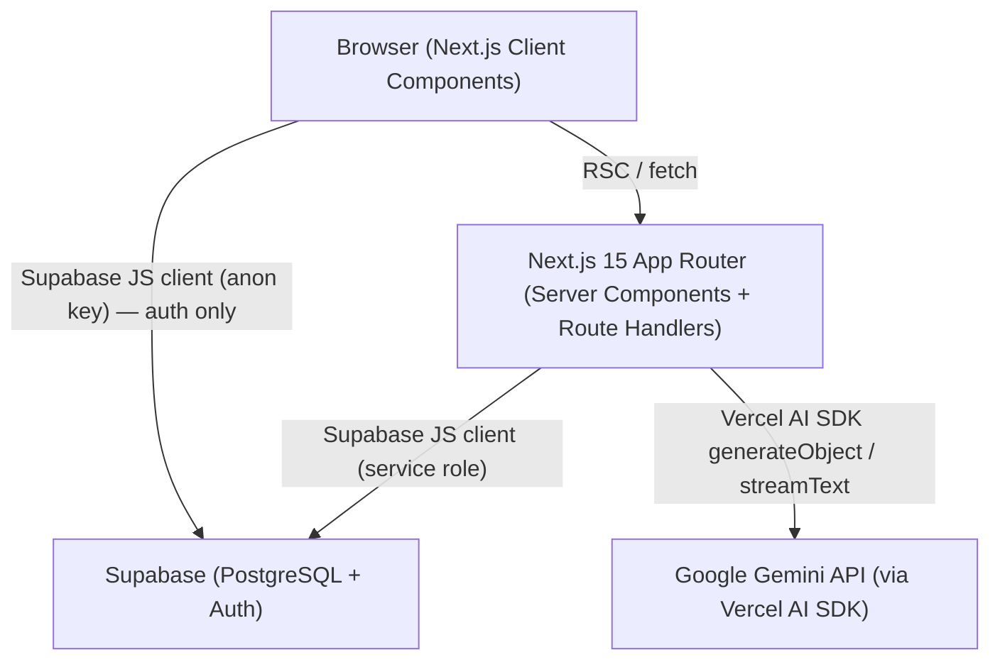
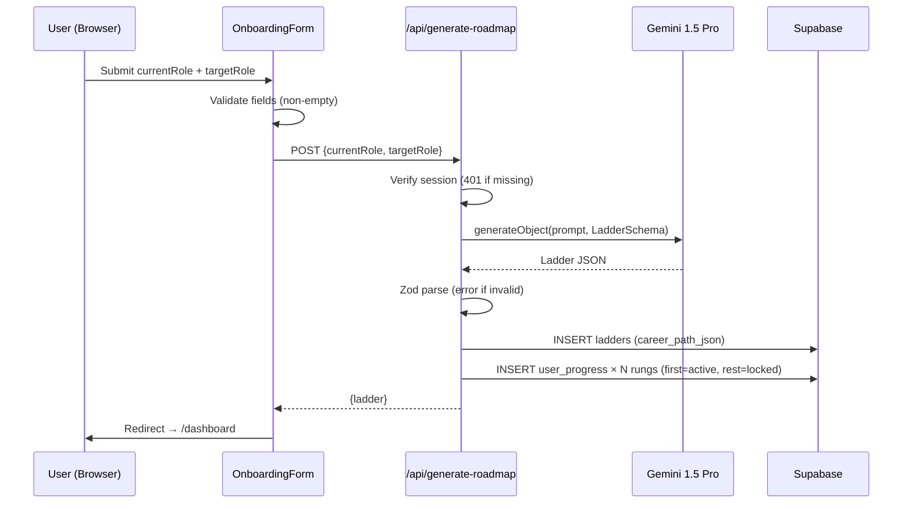
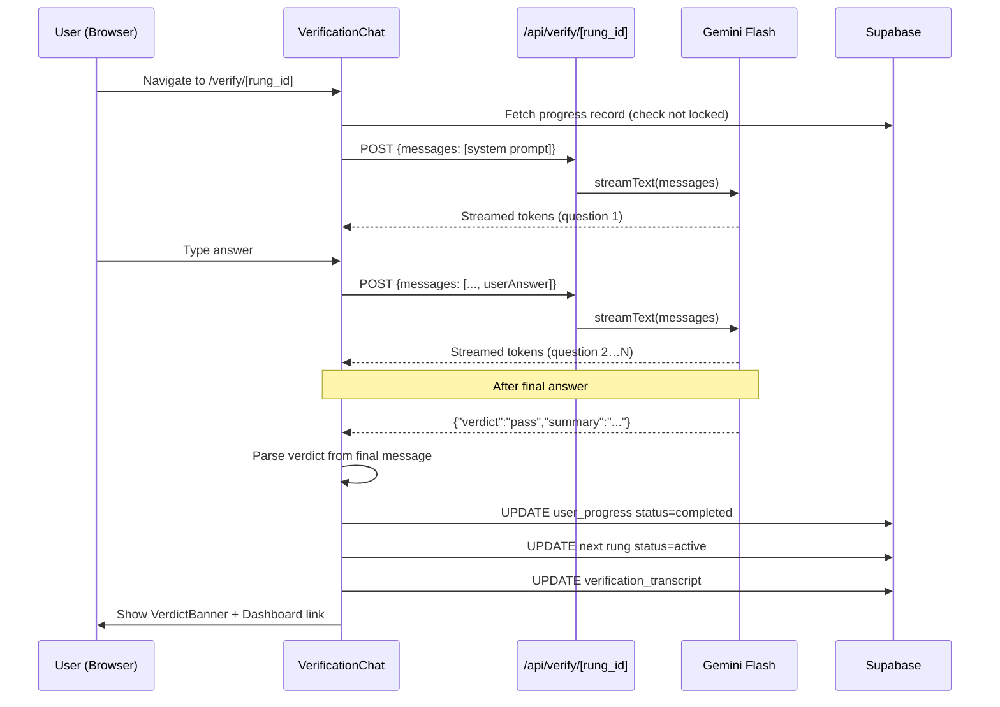

# Design Document: Ascend AI Career Ladder

## Overview

Ascend is a Next.js 15 (App Router) web application that generates personalized AI-driven career roadmaps and validates user competency through AI-powered technical interviews. The system integrates Google Gemini models via the Vercel AI SDK, persists all data in Supabase (PostgreSQL), and presents an animated dark-mode dashboard built with Tailwind CSS and Shadcn/UI.

### Key Design Decisions

- **Server-side AI calls only**: All Gemini API calls happen in Next.js Route Handlers to keep credentials off the client.
- **Streaming verification**: The `/api/verify/[rung_id]` route uses Vercel AI SDK's `streamText` to deliver real-time interviewer responses.
- **Supabase RLS as the security boundary**: Row Level Security policies enforce per-user data isolation at the database layer, complementing server-side auth checks.
- **JSON schema validation at the API boundary**: Zod schemas validate Roadmap_AI output before it is persisted, preventing malformed data from entering the database.
- **Framer Motion for progressive disclosure**: Rung cards animate in sequentially to reinforce the "climbing a ladder" metaphor.

---

## Architecture

### High-Level System Diagram



### Request Flow Summary

1. **Auth**: Browser ↔ Supabase Auth (anon key, handled by `@supabase/ssr` helpers).
2. **Roadmap generation**: Browser → POST `/api/generate-roadmap` → Gemini 1.5 Pro → Zod validation → Supabase insert → JSON response.
3. **Dashboard**: Browser → Next.js Server Component → Supabase query → rendered HTML.
4. **Verification**: Browser → POST `/api/verify/[rung_id]` (streaming) → Gemini Flash → streamed tokens → on completion, Supabase update.

---

## Components and Interfaces

### Next.js App Router File Structure

```
src/
├── app/
│   ├── layout.tsx                  # Root layout (dark mode, font, Toaster)
│   ├── page.tsx                    # Landing / sign-in redirect
│   ├── auth/
│   │   ├── sign-in/page.tsx        # Sign-in form
│   │   └── sign-up/page.tsx        # Sign-up form
│   ├── onboarding/
│   │   └── page.tsx                # Role input form (protected)
│   ├── dashboard/
│   │   └── page.tsx                # Career ladder dashboard (protected, RSC)
│   ├── verify/
│   │   └── [rung_id]/
│   │       └── page.tsx            # Verification chat (protected)
│   └── api/
│       ├── generate-roadmap/
│       │   └── route.ts            # POST — Roadmap_AI call
│       └── verify/
│           └── [rung_id]/
│               └── route.ts        # POST — Interviewer_AI streaming call
├── components/
│   ├── auth/
│   │   ├── SignInForm.tsx
│   │   └── SignUpForm.tsx
│   ├── onboarding/
│   │   └── OnboardingForm.tsx
│   ├── dashboard/
│   │   ├── LadderView.tsx          # Orchestrates rung card list
│   │   └── RungCard.tsx            # Individual rung card with status styling
│   ├── verify/
│   │   ├── VerificationChat.tsx    # Chat UI shell
│   │   ├── MessageList.tsx         # Scrollable message history
│   │   ├── MessageBubble.tsx       # Single message (user / AI)
│   │   └── VerdictBanner.tsx       # Pass/fail result display
│   └── ui/                         # Shadcn/UI primitives (Button, Input, Card…)
├── lib/
│   ├── supabase/
│   │   ├── client.ts               # Browser Supabase client (anon key)
│   │   └── server.ts               # Server Supabase client (service role, cookies)
│   ├── ai/
│   │   ├── roadmap.ts              # generateRoadmap() — wraps Vercel AI SDK
│   │   └── interviewer.ts          # buildInterviewerMessages() — prompt builder
│   ├── schemas/
│   │   ├── roadmap.ts              # Zod schema for Ladder / Rung
│   │   └── verification.ts         # Zod schema for verdict response
│   └── utils.ts                    # Shared helpers (cn, formatDate…)
├── hooks/
│   ├── useVerificationChat.ts      # useChat wrapper with verdict detection
│   └── useProgressUpdate.ts        # Mutation hook for progress status
├── types/
│   └── index.ts                    # Shared TypeScript types
└── middleware.ts                   # Supabase session refresh + route protection
```

### Component Hierarchy

#### Dashboard

```
DashboardPage (RSC)
└── LadderView (Client Component)
    ├── <h1> target_role heading
    └── AnimatePresence (Framer Motion)
        └── RungCard[] (one per rung, staggered entry)
            ├── Card header: rung title + status badge
            ├── Card body: description
            └── [active only] "Start Verification" Button → /verify/[rung_id]
```

#### Verification Chat

```
VerifyPage (RSC — loads rung data, checks lock status)
└── VerificationChat (Client Component)
    ├── MessageList
    │   └── MessageBubble[] (role: user | assistant)
    ├── <form> input + send button
    └── VerdictBanner (rendered when verdict detected in stream)
        ├── Pass: summary + "Back to Dashboard" link
        └── Fail: summary + "Retry" button
```

### API Route Interfaces

#### POST `/api/generate-roadmap`

```typescript
// Request body
interface GenerateRoadmapRequest {
  currentRole: string;
  targetRole: string;
}

// Response (200 OK)
interface GenerateRoadmapResponse {
  ladder: Ladder;
}

// Error response (400 / 401 / 500)
interface ApiError {
  error: string;
}
```

#### POST `/api/verify/[rung_id]`

```typescript
// Request body
interface VerifyRequest {
  messages: CoreMessage[]; // Vercel AI SDK CoreMessage[]
}

// Response: text/event-stream (Vercel AI SDK StreamingTextResponse)
// Final assistant message contains embedded JSON verdict:
// { "verdict": "pass" | "fail", "summary": string }
```

---

## Data Models

### TypeScript Types

```typescript
// types/index.ts

export interface Rung {
  id: string;                        // e.g. "rung_1" — positional, generated client-side
  title: string;
  description: string;
  learning_resources: string[];
  verification_criteria: string[];
}

export interface Ladder {
  rungs: Rung[];
}

export type RungStatus = "locked" | "active" | "completed";

export interface ProgressRecord {
  id: string;
  user_id: string;
  rung_id: string;
  status: RungStatus;
  verification_transcript: string | null;
}

export interface Profile {
  id: string;
  username: string;
  target_role: string;
}

export interface VerificationVerdict {
  verdict: "pass" | "fail";
  summary: string;
}

export interface RungWithProgress extends Rung {
  progress: ProgressRecord;
}
```

### Zod Schemas

```typescript
// lib/schemas/roadmap.ts
import { z } from "zod";

export const RungSchema = z.object({
  id: z.string(),
  title: z.string().min(1),
  description: z.string().min(1),
  learning_resources: z.array(z.string()).min(1),
  verification_criteria: z.array(z.string()).min(1),
});

export const LadderSchema = z.object({
  rungs: z.array(RungSchema).min(5).max(7),
});

// lib/schemas/verification.ts
export const VerdictSchema = z.object({
  verdict: z.enum(["pass", "fail"]),
  summary: z.string().min(1),
});
```

### Database Schema (SQL DDL)

```sql
-- Enable UUID extension
create extension if not exists "uuid-ossp";

-- profiles
create table public.profiles (
  id          uuid primary key references auth.users(id) on delete cascade,
  username    text not null,
  target_role text
);

-- ladders
create table public.ladders (
  id               uuid primary key default uuid_generate_v4(),
  user_id          uuid not null references public.profiles(id) on delete cascade,
  career_path_json jsonb not null,
  created_at       timestamptz not null default now()
);

-- user_progress
create table public.user_progress (
  id                       uuid primary key default uuid_generate_v4(),
  user_id                  uuid not null references public.profiles(id) on delete cascade,
  rung_id                  text not null,
  status                   text not null check (status in ('locked', 'active', 'completed')),
  verification_transcript  text,
  updated_at               timestamptz not null default now(),
  unique (user_id, rung_id)
);

-- RLS: profiles
alter table public.profiles enable row level security;
create policy "profiles: owner access"
  on public.profiles for all
  using (id = auth.uid())
  with check (id = auth.uid());

-- RLS: ladders
alter table public.ladders enable row level security;
create policy "ladders: owner access"
  on public.ladders for all
  using (user_id = auth.uid())
  with check (user_id = auth.uid());

-- RLS: user_progress
alter table public.user_progress enable row level security;
create policy "user_progress: owner access"
  on public.user_progress for all
  using (user_id = auth.uid())
  with check (user_id = auth.uid());
```

---

## AI Prompt Engineering

### Roadmap_AI (Gemini 1.5 Pro)

The roadmap generation uses `generateObject` from the Vercel AI SDK with a Zod schema to enforce structured output.

```typescript
// lib/ai/roadmap.ts
import { generateObject } from "ai";
import { google } from "@ai-sdk/google";
import { LadderSchema } from "@/lib/schemas/roadmap";

export async function generateRoadmap(
  currentRole: string,
  targetRole: string
): Promise<Ladder> {
  const { object } = await generateObject({
    model: google("gemini-1.5-pro"),
    schema: LadderSchema,
    prompt: `You are a senior engineering career coach.
Generate a structured career ladder for someone transitioning from "${currentRole}" to "${targetRole}".

Return between 5 and 7 rungs. Each rung represents a concrete skill milestone.

For each rung provide:
- title: short skill milestone name (e.g. "Master TypeScript Generics")
- description: 2-3 sentences explaining what this milestone covers and why it matters
- learning_resources: 3-5 specific resources (book titles, course names, documentation URLs)
- verification_criteria: 3-5 concrete, scenario-based criteria an interviewer could use to verify competency

Order rungs from foundational to advanced. Be specific and actionable.`,
  });

  return object as Ladder;
}
```

### Interviewer_AI (Gemini Flash)

The interviewer uses `streamText` with a system prompt that instructs the model to conduct a structured interview and embed a JSON verdict in its final message.

```typescript
// lib/ai/interviewer.ts
export function buildSystemPrompt(rung: Rung): string {
  return `You are a Senior Technical Interviewer conducting a competency assessment.

Rung being assessed: "${rung.title}"
Description: ${rung.description}

Verification criteria:
${rung.verification_criteria.map((c, i) => `${i + 1}. ${c}`).join("\n")}

INSTRUCTIONS:
1. Ask between 3 and 5 scenario-based questions derived from the verification criteria above.
2. Ask one question at a time. Wait for the candidate's response before proceeding.
3. After all questions have been answered, evaluate the full conversation.
4. Output your final message as valid JSON in this exact format:
   {"verdict":"pass","summary":"<explanation>"}
   or
   {"verdict":"fail","summary":"<explanation>"}
5. Do not include any text outside the JSON in your final message.
6. Be professional, encouraging, and specific in your feedback.`;
}
```

---

## Data Flow Diagrams

### Onboarding Flow



### Verification Flow



---

## Environment Variable Configuration

| Variable | Scope | Description |
|---|---|---|
| `NEXT_PUBLIC_SUPABASE_URL` | Public (client + server) | Supabase project URL |
| `NEXT_PUBLIC_SUPABASE_ANON_KEY` | Public (client + server) | Supabase anon key for auth |
| `SUPABASE_SERVICE_ROLE_KEY` | Server only | Supabase service role key for DB mutations |
| `GOOGLE_GENERATIVE_AI_API_KEY` | Server only | Google Gemini API key |

All server-only variables are accessed exclusively inside Route Handlers and Server Components. They are never referenced in Client Components.

### Middleware (Route Protection)

```typescript
// middleware.ts
import { createServerClient } from "@supabase/ssr";
import { NextResponse } from "next/server";
import type { NextRequest } from "next/server";

const PROTECTED_PATHS = ["/onboarding", "/dashboard", "/verify"];

export async function middleware(request: NextRequest) {
  const response = NextResponse.next();
  const supabase = createServerClient(/* ... */);
  const { data: { session } } = await supabase.auth.getSession();

  const isProtected = PROTECTED_PATHS.some(p =>
    request.nextUrl.pathname.startsWith(p)
  );

  if (isProtected && !session) {
    return NextResponse.redirect(new URL("/auth/sign-in", request.url));
  }

  return response;
}

export const config = {
  matcher: ["/onboarding/:path*", "/dashboard/:path*", "/verify/:path*"],
};
```

---

## Error Handling

| Scenario | Handling |
|---|---|
| Gemini returns malformed JSON | Zod parse fails → API returns 500 with `{ error: "Roadmap generation failed" }` |
| Gemini API key invalid / quota exceeded | Caught in Route Handler → 500 with descriptive message |
| Supabase insert fails | Caught in Route Handler → 500; client shows toast error |
| Unauthenticated API request | Middleware + Route Handler both check session → 401 |
| User navigates to locked rung | Server Component checks status → `redirect("/dashboard")` |
| Onboarding form empty fields | Client-side Zod validation → inline field errors, no API call |
| Auth failure (sign-in/sign-up) | Supabase error message surfaced via `useState` in form component |
| Verdict JSON not parseable | `VerificationChat` catches parse error → shows generic failure message + retry |

---
